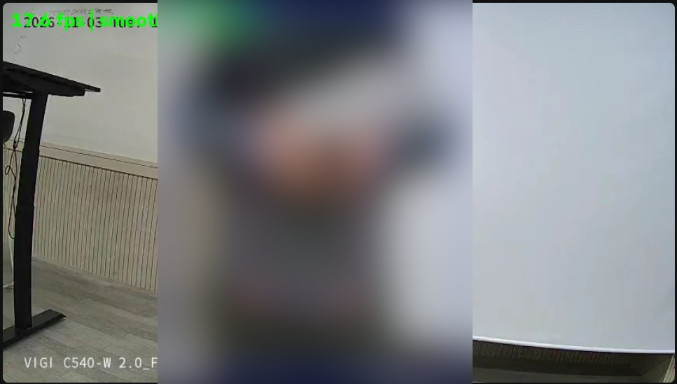
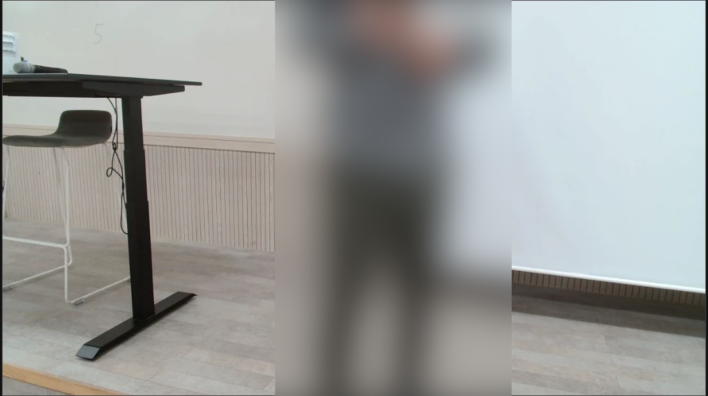

# 결과 보고서 — Jetson 카메라 응용 실습

AIGJ_01_008 박민수 · 측정 11/2~11/3 · 트랙 기본(A)과 일부 심화(B)

시험마다의 전체 과정과 재시험 기록은 [docs/DETAILS.md](docs/DETAILS.md), 확인 문제 답안은 [ANSWERS.md](ANSWERS.md), 다른 팀용 결과 형식 문서는 [INTERFACE.md](INTERFACE.md), 항목별 시험 판정은 [runs/test_log.md](runs/test_log.md)에 있다.

## 0. 공통 측정 조건

| 항목 | 값 |
| --- | --- |
| 보드 | Jetson Orin Nano Super 8GB, JetPack 7.2.1, 전력 모드 MAXN\_SUPER |
| 실행 환경 | 호스트 Python venv (컨테이너 아님), 공용 보드(다른 팀원 작업이 함께 돎) |
| 웹캠 | Logitech C920 PRO (USB), 높이 1.2 m, 아래로 약 15°, 자동 초점 켜짐 |
| IP 카메라 | TP-Link VIGI C540-W, Jetson 유선 포트에 직결, 메인 2560x1440·서브 848x480, 25 fps, H.264, 높이 1.08 m, 수평 |
| 모델 | yolo11n / yolo11s(검출), yolo11n-pose(자세), yoloe-11s-seg(개방 어휘), EmbeddingGemma 2(재라벨), 별도 표시 없으면 PyTorch |
| 조명 | 교육장 천장 조명, 낮에는 창문 빛이 섞임 |
| 상시 서비스 | A1 재실 인원(포트 8095), A3 안내판 행동(포트 8001)이 측정 내내 켜져 있음 |

실습 키트 폴더(`IP카메라 객체인식 실습/`, `스테레오 거리 실습/`)를 보드에서 찾지 못해, 필요한 도구는 직접 만들었다(`code/` 아래 `cam1.py`, `line_count.py`, `light_dist.py`, `shift_stereo.py` 등). 사람이 나온 사진은 흐림 처리했다.

## 1. 과제 1 — 카메라 연동과 기준선

| 입력 | 실측 FPS | 해상도 | 첫 프레임 지연 | 프로세스 CPU | glass-to-glass |
| --- | --- | --- | --- | --- | --- |
| C920 USB | 30.0 | 1280x720 | 638 ms | 35.7% | 1초 이하 (640x480 뷰어) |
| VIGI RTSP | 27.1 | 848x480 | 1216 ms | 6.3% | 새로고침 직후 4.7초, 61초 뒤 6.6초 |

**수신 방식별 지연 (프레임마다 0.2초 처리 지연, 120초 뒤)**

| 입력 | (a) `read()` 반복 | (b) 최신 1장 리더 |
| --- | --- | --- |
| C920 | 약 0.85초에서 멈춤 (드라이버 버퍼가 참) | 약 8 ms |
| VIGI | **96.2초, 계속 증가** | 증가 없음 |

VIGI (a)는 초당 25장이 들어오는데 5장만 처리하므로 밀린 양이 초당 0.8초씩 쌓인다(120초 × 0.8 = 96초, 실측과 일치). (b)는 지연을 없애는 대신 모든 프레임을 받아야 해 C920의 CPU가 7.4%에서 44.3%로 올랐다. VIGI glass-to-glass는 영상에 찍힌 카메라 시계(NTP, ONVIF로 Jetson과 1초 안 확인)와 브라우저 시계를 비교했다. 켜 둘수록 늘고 새로고침하면 줄어, 늘어난 부분은 원격 뷰어(MJPEG)의 전송 밀림이다.

**재연결:** VIGI 랜선을 뽑았다 꽂아도 두 서비스 모두 재시작 없이 다시 연결했다(각 1회). A1은 끊김을 5.7초 안에 표시하고, 다시 연결된 읽기에서 2초 안에 정상으로 돌아왔다. 다만 랜선을 다시 꽂은 시각을 적지 않아 "꽂은 뒤 30초 안 복구"는 수치로 보이지 못했다. 시험 중 A3가 영상만 멈추는 문제를 찾아 고쳤다(6장).

**설치 위치(T0-3):** 사람이 화면에 들어오기 시작하는 거리는 C920 1.08 m, VIGI 0.86 m다. 1 m 근처에서는 두 카메라 모두 머리가 잘려, 동작 시험은 2~3 m에서 했다.

| VIGI, 1.10 m | C920, 1.25 m |
| --- | --- |
|  |  |

**심화: 하드웨어 디코딩.** VIGI 메인 스트림(2560x1440)을 GStreamer로 60초씩 받았다. NVDEC(`nvv4l2decoder`)와 CPU(`openh264dec`) 모두 25 fps였고, 프로세스 CPU는 코어 1개 기준 4.2%와 30.1%였다. 같은 VIGI의 서브 스트림은 메인보다 화소가 약 9분의 1이고 CPU도 6.2% 대 38.0%로 약 6분의 1이라, 두 서비스는 서브 스트림을 쓴다.

## 2. 과제 2 — 물체 인식

**벤치마크 (입력 640, 1280x720 임의 영상 200회, 서비스 2개 가동 중, mAP는 coco128)**

| 모델 | 평균 ms | p95 ms | FPS | mAP50-95 | 보드 전력 평균 |
| --- | --- | --- | --- | --- | --- |
| PyTorch yolo11n | 29.03 | 30.47 | 34.4 | 0.508 | 13.2 W |
| PyTorch yolo11s (큰 모델) | 29.97 | 33.3 | 33.4 | 0.576 | (같은 구간) |
| TensorRT FP16 yolo11n | **11.48** | 14.87 | 87.1 | 0.503 | 10.9 W |
| INT8 / 큰 모델 FP16 | 보류 | | | | |

FP16 엔진은 정확도를 0.005만 잃고 2.5배 빨라졌다. 그러나 기준(10 ms 이하)에는 1.48 ms 못 미쳤다. 서비스 2개가 같은 GPU를 쓰는 상태에서 잰 값이다. PyTorch에서 yolo11s가 yolo11n과 거의 같은 속도인 것은, 시간의 대부분이 모델 계산보다 이 보드용으로 빌드되지 않은 PyTorch의 GPU 실행 부담이기 때문이다(엔진 전환으로 줄어든 17.5 ms가 그 부분). FP16 변환 중 남은 메모리가 456 MB까지 내려가, INT8과 yolo11s FP16은 공용 보드의 서비스를 지키려고 보류했다.

**선 통과 (VIGI 서브, yolo11n, ultralytics 기본 추적기 BoT-SORT, 2~3 m)**: 9회 왕복 중 9회를 맞게 셌다(OUT 5, IN 4, 중복 0). 기준은 10회 오차 1 이하로, 9회까지는 오차 0이다. 이 시험에서는 MQTT 발행 옵션을 켜지 않았다.

**조명×거리 (VIGI 서브, 칸마다 30초)**

| 조명 | 0.93 m | 2 m |
| --- | --- | --- |
| 밝음 | 검출률 100%, 신뢰도 0.949 | 95.1%, 0.884 |
| 어두움 (낮, 앞쪽 조명만 끔) | 100%, 0.938 | 100%, 0.927 |

방이 2 m까지라 5 m, 8 m는 재지 못했다. "어두움"은 화면 밝기가 117~125로 켠 상태와 거의 같았다. 창문 빛과 카메라 자동 노출 때문이므로, 이 결과로 실제 어두운 환경을 말할 수는 없다.

**물품 인식 (VIGI 서브, 약 1 m, 라벨 목록 9개)**

| 물건 | COCO | yolo | relabel | yoloe |
| --- | --- | --- | --- | --- |
| 우산 (접힘) | 있음 | bed | 우산 | 못 잡음 |
| 컵 | 있음 | remote, cup | 컵 | cup |
| 꽂이 (흰 구멍 판) | 없음 | cell phone | 꽂이 | 못 잡음 |
| 상자 | 없음 | suitcase | 상자 | cardboard box |
| 줄자 | 없음 | cell phone | 줄자 | 못 잡음 |
| 정답 | | 1/5 | **5/5** | 2/5 (틀린 이름 0) |

yolo는 모르는 물건에 비슷한 COCO 이름을 자신 있게 붙였고, 같은 물건도 시험마다 이름이 달랐다(상자: suitcase, umbrella, refrigerator). relabel은 모두 맞혔지만, 정답이 모두 든 9개짜리 목록이라 유리한 조건이다. yoloe는 이름은 틀리지 않았지만 3개를 놓쳐 기준(5종 중 4종)에 못 미쳤다. "pen holder"라는 문구가 실제 모양과 달랐고, 줄자는 손에 쥐면 작다. 물품 중 COCO에 없는 것은 3종뿐이다. 오인식 사례 캡처는 [docs/DETAILS.md](docs/DETAILS.md) 과제 2에 있다.

## 3. 과제 3 — 재실 인원 카운터

A1은 VIGI 화면 전체를 직접 계수하고, yolo11n(입력 640, conf 0.4)의 사람 수를 30초 median으로 평활해 10초마다 MQTT(retain)로 낸다.

| 평가 | 칸 | MAE | ±1명 이내 | 빈 방 오판율 |
| --- | --- | --- | --- | --- |
| 밤 빈 방 (11/2 19:00~11/3 06:00) | 657 | - | - | **0%** |
| 낮 30분 (11:24~11:53, 정답 30칸 모두 0명) | 30 | 0.00 | 100% | 0% |
| 1명 칸 (오후 시험 기록과 대조) | 5 | 0.40 | 100% | - |
| 2명까지 10분 (16:40~16:49, 2명 1·1명 2·0명 7칸) | 10 | 0.00 | 100% | 0% |

세 기준(MAE ≤ 1.0, ±1명 ≥ 80%, 빈 방 오판 ≤ 10%)을 모두 넘었다. 다만 사람이 있던 칸은 15개, 2명 칸은 1개뿐이다. 3명 이상과 겹침은 시험하지 않았다.

**편향 사례:** 1명 칸 5개 중 2개에서 순간 값은 1, 30초 중간값은 0이었다. 둘 다 사람이 들어온 지 10~15초 된 시점으로, 창의 절반이 차기 전이었다. 즉 이 서비스의 오차는 가림이나 크기가 아니라 **평활 창이 만드는 지연**에서 나왔다(과소 편향). 밤 기록 1,105개에서도 순간 값과 중간값이 다른 10개는 모두 사람이 드나들던 시간이었고, 빈 방에서는 순간 검출부터 0이었다.

빠진 것: 출입 계수와의 30분 동시 운영, 설치 높이·각도·역광 비교, 구역(include/exclude) 설정, imgsz×조각·window×stat 비교표.

## 4. 과제 4 — 행동 패턴 인식

A3(`pose_app.py`)는 yolo11n-pose로 17관절을 구하고, 동작은 0.6초 다수결로 안정화한 규칙으로, 행동은 정면 점수·이동 속도·체류 시간 규칙으로 판정한다(VIGI 서브, 2~3 m).

| 시험 | 기준 | 결과 | 판정 |
| --- | --- | --- | --- |
| 안정화 동작 10회 (만세) | 9회 이상, 깜빡임 ≤ 1 | 10/10, 중복 0 | 합격 |
| 한팔 들고 정지 | WAVE 오판 ≤ 1/10 | 약 12회 중 2회 | 불합격 |
| 행동 패턴 12회 | 10회 이상 | 11/12 (머무름 재측정 반영) | 합격 |
| 혼동 사례 | 5건 이상 | 5건 (연기 오류 1건 제외) | 합격 |
| 악수 (2명) | - | 원래 기준 0회 → 완화 뒤 약 3/4 | 참고 |

**행동 12회 혼동 행렬 (1차, 머무름은 연기 오류)**

| 정답 \ 판정 | 지나감 | 힐끗 봄 | 관심 있음 | 머무름 |
| --- | --- | --- | --- | --- |
| 지나감 | 3 | 0 | 0 | 0 |
| 힐끗 봄 | 0 | 3 | 0 | 0 |
| 관심 있음 | 1 | 0 | 2 | 0 |
| 머무름 | 0 | 0 | 3 | 0 |

머무름 3회가 모두 관심 있음으로 나온 것은 시험자가 정면을 봤기 때문이다(연기 오류). 옆을 보고 다시 한 3회는 모두 머무름이었다. 같은 자리에 서 있어도 시선 방향 하나로 판정이 갈렸다.

**원인과 조치:** 한팔 정지의 손흔들기 오판 2회와 만세 사이의 손흔들기 5회는, 팔을 빠르게 올리고 내릴 때 손목이 팔꿈치 위를 좌우로 지나가 흔들기 규칙(1.5초 안 방향 전환 2번)에 걸린 것이다. 회차가 약 2.3초로 짧아 0.6초 다수결이 걸러 내지 못했다. 손목이 팔꿈치 위에 0.5초 이상 있을 때만 흔들기로 보면 줄어들 것이다(미적용). 악수는 원래 기준(손목 거리 어깨 너비 0.5배, 손목 신뢰도 0.5)에서 한 번도 잡히지 않았다. 맞잡은 손목은 서로 가려 신뢰도가 떨어지고, 옆모습에서는 어깨 너비가 좁아져 거리 기준이 거의 0이 된다. 기준을 1.0배, 0.3으로 풀어 약 4회 중 3회를 잡았고, 놓친 1회는 연속 악수가 하나로 이어진 것이다. 풀린 기준의 오검출(가까이 서기만)은 시험하지 않았다.

빠진 것: raw 모드와의 깜빡임·지연 비교, GRU 학습(B).

## 5. 과제 5 — 거리 측정

같은 모델 웹캠 2대와 키트가 없어, **C920 1대를 8 cm 옮겨 두 번 찍는 대체 방식**(`shift_stereo.py`)으로 정지한 물체만 쟀다. 초점거리는 embedding\_gemma2 과제에서 같은 C920으로 만든 보정 파일(fx ≈ 681 px, 640x480)을 썼다. 도구의 가상 시차 시험은 3점 모두 0.02 px 안이었다.

| 물체 | 실제 (줄자) | 측정 | 오차 | 기준 |
| --- | --- | --- | --- | --- |
| 의자 등받이 | 1.4 m | 1.35 m | −3.6% | ≤ 5% 합격 |
| 꽂이 윗면 | 1.9 m (앞면) | 2.12 m | +12% 이하 | 판정 불가 |

모니터에 단 채 옮긴 처음 두 번은 카메라가 12~16° 돌아가 버렸다. 책상 위에서 다시 했어도 약 2° 돌고 기울어, 거리를 아는 두 점(상자 1.7 m, 스크린 2.0 m)으로 회전과 기울기를 빼고 나머지로 검증했다. 손으로 옮기는 방식의 한계이며, 보정 25쌍·재투영 오차·3~4 m 측정·측정 불가 조건 4가지·사람별 거리는 하지 못했다.

## 6. 과제 6 — 응용 서비스

**현장 문제:** 교육장에는 CO₂·온습도 센서는 있지만 사람을 보는 수단이 없다. A1은 방의 인원을 숫자로, A3은 안내판 앞 사람이 지나가는지 멈춰 보는지를 이벤트로 낸다. 영상은 보드 밖으로 내보내지 않고, 다른 팀은 MQTT와 REST로 가져다 쓴다([INTERFACE.md](INTERFACE.md)).

| 확인 기준 | 결과 | 판정 |
| --- | --- | --- |
| 12시간 무중단 | A3 12시간 37분(758행, 평균 21.1 fps, 재연결 0, 재시작 0), A1 13시간 7분(재연결 0, 저장 이미지 0) | 합격 |
| 카메라 분리·복귀 | 두 서비스 재시작 없이 자동 재연결 | 합격 |
| 재부팅 3분 안 복귀 | A1 약 1분, A3 2분 안 (11/3 16:29) | 합격 |
| 결과 형식 문서 | INTERFACE.md | 합격 |
| 운영 모드 영상 저장 0건 | 두 서비스 저장 호출 없음 | 합격 (뷰어는 운영 때 끔) |

**장애에서 찾아 고친 것:** 랜선 분리 시험에서 A1은 52초 동안 오래된 값을 `정상`으로 보였다. 마지막 프레임 나이로 5.7초 안에 `끊김`을 표시하게 고쳤다. A3는 프로세스가 살아 있는 채 영상만 멈췄다(재연결 조건이 실패 50회 누적). 2.5초 시간 기준 재연결과, 120초 프레임이 없으면 스스로 종료해 systemd가 다시 띄우는 감시를 넣었다.

**자원 계획 (계산 vs 실측)**

| 항목 | 계산 | 실측 |
| --- | --- | --- |
| 두 서비스 메모리 | 약 1.2 GB + 1.3 GB ≈ 2.5 GB (보드의 33%) | 남은 메모리 1.3~2.2 GB, 12시간 중 최소 422 MB |
| 카메라 4대 디코딩 | CPU 4 × 30.1% ≈ 코어 1.2개, NVDEC ≈ 0.17개 | 1대 30.1% / 4.2% |
| GPU | A1 추론 약 41 ms, A3 약 21 fps | 평균 25.7%, 최대 99% |
| 전력 | 9.1 W × 24시간 ≈ 218 Wh/일 | 평균 9.1 W, 최대 17.3 W |

카메라를 늘리면 메모리가 먼저 바닥난다. 두 서비스를 한 프로세스로 합쳐 PyTorch·CUDA 실행 환경을 한 번만 올리거나 TensorRT 엔진으로 바꾸는 것이 먼저다. 전력과 자원은 jtop 대신 tegrastats(1분 간격 774회)로 쟀다. USB 설정을 서비스 시작 전에 복구하는 처리는, 두 서비스가 IP 카메라를 써서 넣지 않았다.

## 7. 설계 변수 하나를 바꿔 가장 크게 달라진 것

**수신 방식 (a) → (b)**: 같은 VIGI, 같은 0.2초 처리에서 2분 뒤 지연이 96.2초에서 0으로 바뀌었다. 모델·해상도·하드웨어를 하나도 바꾸지 않고 프레임을 받는 방식만 바꾼 결과다. 그다음으로 큰 것은 **추론 엔진(PyTorch → TensorRT FP16)**으로 29.03 ms → 11.48 ms(정확도 −0.005), **평활 창(순간 → 30초 median)**은 빈 방 오판은 그대로 0이지만 사람이 들어온 뒤 약 15초의 반응 지연을 만들었다(1명 칸 2/5).

## 8. 기준 대비 요약과 한계

| 과제 | 기준 충족 | 못 미친 것 |
| --- | --- | --- |
| 1 | FPS·지연·리더 비교·glass-to-glass·원격 뷰어 | 재연결 30초를 수치로 못 보임 |
| 2 | 선 통과, mAP 비교 | FP16 11.48 ms(기준 10), INT8·큰 모델 보류, yoloe 2/5, 5·8 m 없음 |
| 3 | MAE·±1명·빈 방 오판 | 출입 계수 비교, 설계 변수표, 사람 칸 적음 |
| 4 | 안정화 10/10, 행동 11/12, 혼동 5건 | 한팔 오판 2회, raw 비교 없음, 악수는 기준 완화 |
| 5 | 1.4 m −3.6% | 정식 스테레오·보정·3~4 m 전부 |
| 6 | 12시간, 분리, 재부팅, 형식 문서, 저장 0 | jtop 대신 tegrastats |

시험자는 1~2명이었고, 공용 보드에서 다른 작업과 함께 쟀다. 정답은 대부분 시험자가 정한 순서나 시각 기록으로 정했고, 2명 시험은 칸별 정답 파일을 남기지 못했다.
