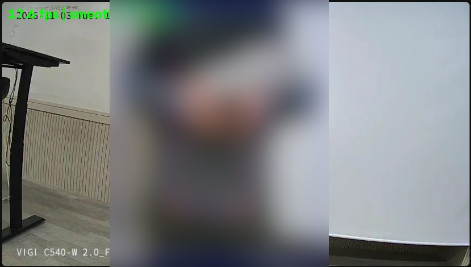
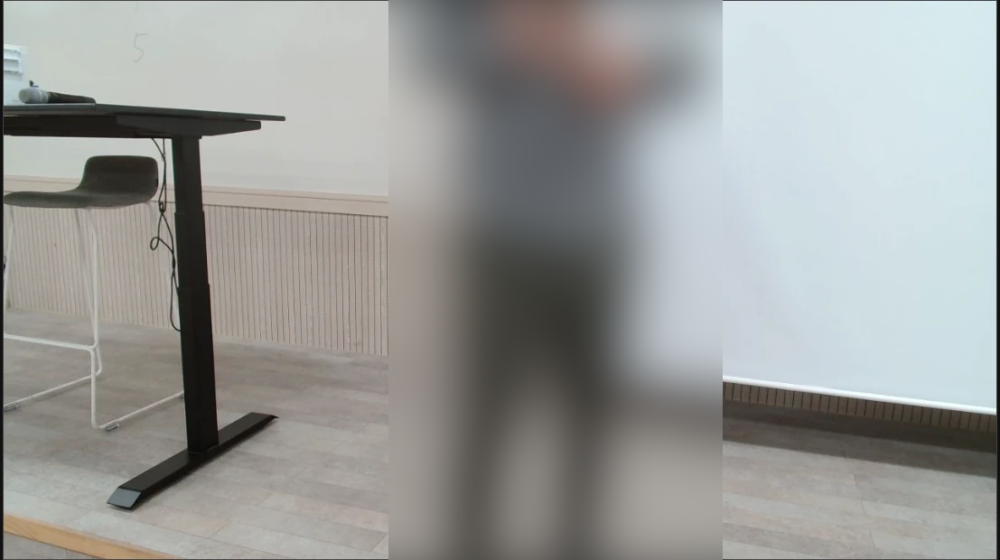
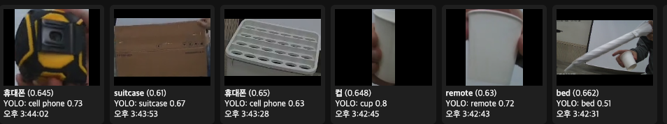
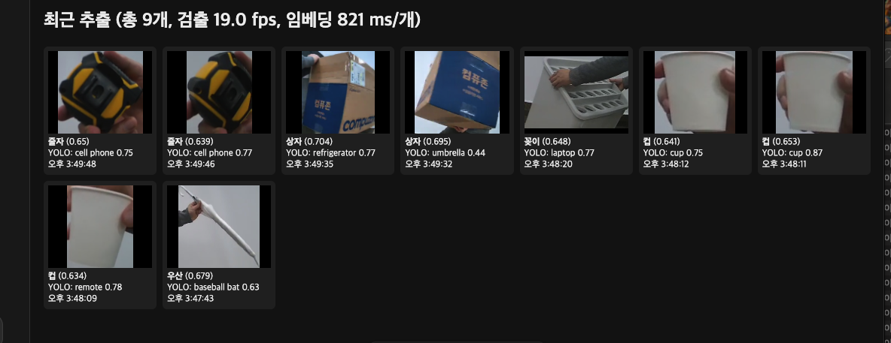
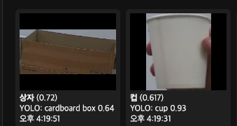
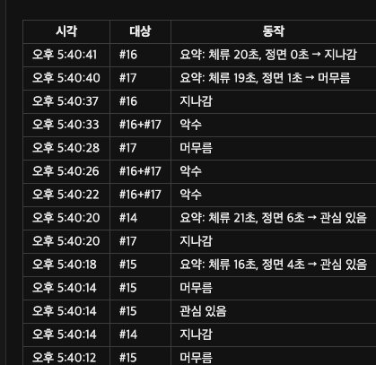

# 상세 기록 — Jetson 카메라 응용 실습

AIGJ_01_008 박민수 · 11/2~11/3 측정. 요약 보고서는 [REPORT.md](../REPORT.md), 확인 문제 답안은 [ANSWERS.md](../ANSWERS.md), 결과 형식 문서는 [INTERFACE.md](../INTERFACE.md)에 있다. 이 파일은 시험마다의 전체 과정, 재시험, 실패 기록을 남긴다.

## 심화(B) 항목 현황

기본 과제에 더해 다음 심화 항목을 진행했다.

- **과제 4, 규칙 임계값 분석:** 머무름 시험에서 같은 자리에 서 있어도 시선이 카메라 정면이면 `관심 있음`, 옆이면 `머무름`으로 판정이 갈리는 것을 확인했다. 응시·체류 임계값보다 시선 방향이 판정을 더 크게 바꾼다.
- **과제 6, 서비스 스스로 감시:** A1은 프레임이 5초 넘게 들어오지 않으면 `끊김(프레임 없음)`을 표시하고 이벤트를 남긴다. A3는 120초 동안 프레임이 없으면 스스로 종료해 systemd가 다시 시작한다. 두 기능 모두 카메라 분리 시험에서 찾은 문제를 고치며 넣었다.
- **과제 1, 하드웨어 디코딩 비교:** VIGI 메인 스트림(2560x1440)을 NVDEC와 CPU(openh264)로 디코딩해 비교했다. 둘 다 25 fps였고 프로세스 CPU는 4.2%와 30.1%(코어 1개 기준)였다. 결과는 과제 1에 있다.

## 과제 1. 카메라 연동과 기준선

웹캠(Logitech C920 PRO)과 IP 카메라(VIGI C540-W stream2, 랜선 직결)를 11/3에 cam1.py로 쟀다. 실행 환경은 Jetson 호스트의 venv이고, 전력 모드는 MAXN_SUPER이며, 서비스 2개(A1, A3)가 켜진 상태다. VIGI glass-to-glass는 영상에 찍힌 카메라 시계로 재었다.

| 입력 | 실측 FPS | 해상도 | 첫 프레임 지연 | CPU | glass-to-glass |
| --- | --- | --- | --- | --- | --- |
| C920 USB | 30.0 | 1280x720 | 638 ms (열기 251 ms) | 프로세스 35.7%, 보드 27.6% | 1초 이하 (640x480 뷰어, 눈대중) |
| VIGI RTSP | 27.1 | 848x480 | 1216 ms (열기 1207 ms) | 프로세스 6.3%, 보드 21.4% | 약 4\~5초, 1분 뒤 약 6\~7초 (640x480 뷰어, 아래 설명) |

**설치 위치와 초점 (T0-3)**

11/3에 줄자로 쟀다. 각도는 눈대중이고, 보이기 시작하는 거리는 사람이 앞뒤로 움직이며 뷰어로 확인한 값이다. C920 초점 설정은 `v4l2-ctl`로 읽었다.

| 카메라 | 렌즈 높이 | 아래로 숙인 각도 | 사람이 보이기 시작하는 거리 | 초점 | 줌 |
| --- | --- | --- | --- | --- | --- |
| C920 | 1.2 m | 약 15° | 1.08 m | 자동 초점 켜짐 (`focus_automatic_continuous=1`) | 1배 (`zoom_absolute=100`) |
| VIGI | 1.08 m | 0° (수평) | 0.86 m | 고정 렌즈 | 기본 |

C920은 자동 초점이 켜져 있어, 사람이 가까이 오면 초점이 움직인다. 과제 1과 4에는 문제가 없지만, 과제 5 거리 측정에서는 초점이 바뀌면 보정값이 맞지 않으므로 자동 초점을 끄고 값을 고정해야 한다. VIGI는 수평으로 달려 있어 화면 아래쪽에 바닥보다 사람 상반신이 주로 잡힌다.

아래는 사람이 가까이 섰을 때의 화면이다. VIGI는 1.10 m에서 가슴부터 허벅지까지, C920은 1.25 m에서 어깨부터 발까지 보이고, 두 카메라 모두 이 거리에서는 머리가 잘린다. VIGI 화면의 상자와 점은 A3 서비스의 검출 결과(사람 1명)다.

| VIGI, 1.10 m | C920, 1.25 m |
| --- | --- |
|  |  |

**수신 방식별 지연 (프레임마다 0.2초 처리 지연, 120초)**

(a)는 `cap.read()`를 그대로 반복하고, (b)는 별도 스레드가 읽어 최신 1장만 남긴다. 지연 증가는 첫 프레임을 기준으로 잰 값이라 절대 지연이 아니다.

| 입력 | 방식 | 120초 뒤 지연 증가 | 처리 프레임 | CPU |
| --- | --- | --- | --- | --- |
| C920 | (a) | 약 846 ms, 일정 | 556 | 7.4% |
| C920 | (b) | 약 8 ms | 600 | 44.3% |
| VIGI | (a) | 96,228 ms, 계속 증가 | 598 | 1.2% |
| VIGI | (b) | 약 −880 ms, 증가 없음 | 600 | 6.3% |

VIGI (a)는 초당 25장이 들어오는데 5장만 처리해, 밀린 프레임이 초당 1 − 5/25 = 0.8초씩 늘어난다. 120초면 96초로 실측과 맞다. 시험 중 H.264 복원 오류도 1회 나왔다. C920 (a)는 약 0.85초에서 멈추는데, 드라이버 버퍼가 차면 더 쌓이지 않기 때문으로 본다. (b)는 두 입력 모두 지연이 쌓이지 않았다. 대신 들어오는 프레임을 모두 받아야 해 CPU가 늘었고, C920에서는 7.4%에서 44.3%로 올랐다. VIGI (b)의 −880 ms는 기준점 차이로 보이며, 시간이 지나도 늘지 않았다.

**화면 지연**

C920을 1280x720으로 브라우저에 띄우면 지연이 5초에서 18초로 늘고 회색 깨진 프레임이 나왔다. 640x480으로 낮추자 1초 이하로 줄었다. 뷰어의 MJPEG 전송이 원격 접속망에서 밀린 것이므로, 카메라 지연과 구분해야 한다. 값은 사람이 눈으로 본 것이고 스톱워치 측정이 아니다.

VIGI는 브라우저 시계와 영상에 찍힌 카메라 시계의 차이로 재었다. 카메라 시계는 NTP를 쓰고, ONVIF로 읽은 값이 Jetson 시각과 1초 안쪽으로 맞았다. Mac 시계도 맞다고 가정한 값이다. 새로고침 직후 차이가 4.7초, 61초 뒤 6.6초였고, 오래 켜 둔 화면에서는 약 8초였다. 켜 둘수록 늘고 새로고침하면 줄어, 뷰어 전송이 밀리는 것으로 본다. 카메라 시계가 1초 단위라 실제 값은 최대 1초 낮을 수 있다. 새로고침 직후의 약 4\~5초 안에서 카메라, 수신, 원격 전송이 각각 얼마인지는 구분하지 못했다.

**하드웨어 디코딩과 CPU 디코딩 비교 (심화)**

VIGI 메인 스트림(2560x1440, 25 fps, H.264)을 GStreamer로 받아, 디코더만 바꿔 60초씩 재었다(`gst_decode_bench.py`). 디코딩한 화면은 버렸다. 과제 기준인 1080p보다 무거운 입력이며, 서비스 2개가 켜진 상태다.

| 디코더 | FPS | 프로세스 CPU (코어 1개 기준) | 보드 CPU |
| --- | --- | --- | --- |
| NVDEC (`nvv4l2decoder`) | 25.0 | 4.2% | 32.4% |
| CPU (`openh264dec`) | 25.0 | 30.1% | 34.7% |

두 방식 모두 25 fps를 놓치지 않았다. NVDEC는 CPU를 약 7분의 1만 썼고, 차이는 스트림 하나당 코어 1개의 약 26%다. 카메라 4대를 받으면 CPU 디코딩은 코어 1개를 넘게 쓰고, NVDEC는 그 부담을 거의 없앤다. 보드 CPU는 두 서비스의 부하가 대부분이라 차이가 2.3%p로 작게 보인다. 지금 두 서비스는 OpenCV(FFmpeg)로 CPU 디코딩을 하므로, 카메라를 늘릴 때는 GStreamer와 NVDEC로 바꾸는 것이 먼저다. 다만 이 보드의 OpenCV는 GStreamer 없이 빌드돼 있어 코드 변경이 필요하다.

**메인 스트림과 서브 스트림 비교**

같은 VIGI의 두 스트림을 cam1.py(OpenCV, CPU 디코딩)로 20초씩 재었다.

| 스트림 | 해상도 | 실측 FPS | 첫 프레임 | 프로세스 CPU | 보드 CPU |
| --- | --- | --- | --- | --- | --- |
| 메인 (stream1) | 2560x1440 | 26.1 | 1229 ms | 38.0% | 34.9% |
| 서브 (stream2) | 848x480 | 26.1 | 1196 ms | 6.2% | 29.0% |

화소 수는 약 9배이고 프로세스 CPU는 약 6배다. FPS와 첫 프레임 지연은 거의 같다. 메인 스트림의 CPU 38.0%는 같은 입력의 GStreamer CPU 디코딩(30.1%)보다 높은데, OpenCV가 디코딩 뒤 BGR로 변환하는 비용이 더해진 것으로 본다. YOLO는 입력을 640으로 줄이므로, 메인 스트림을 그대로 넣으면 CPU만 더 쓰고 먼 사람은 더 커지지 않는다. 그래서 두 서비스는 서브 스트림을 쓴다. 먼 사람을 봐야 하는 재실 인원에는 메인 스트림을 조각내 입력하고, 디코딩은 NVDEC로 바꾸는 조합이 맞다.

확인 문제 답안은 [ANSWERS.md](../ANSWERS.md)에 있다.

**생각해 볼 점**

- **30fps 입력, 10fps 추론**: 1분에 1,800장이 들어와 600장만 처리하므로 1,200장을 버린다. 버리지 않으면 버퍼가 차서 1분마다 지연이 약 40초씩 쌓인다.
- **메인과 서브 스트림**: 보통은 서브 스트림이 디코딩 부담이 작아 맞다. 재실 인원처럼 먼 사람을 봐야 하면 메인 스트림과 조각 검출이 낫다.
- **NVENC 없음**: 영상을 다시 인코딩하면 CPU를 쓴다. 보드에서는 뷰어용 JPEG만 유지하고 재송출은 끊거나 저해상도로 줄이는 편이 낫다.

## 과제 2. 물체 인식

벤치마크는 PyTorch와 TensorRT FP16으로 재었다(11/3, bench\_yolo.py, 입력 640, 1280x720 임의 영상, 모델마다 200회). 전력 모드는 MAXN\_SUPER이고, 서비스 2개가 같은 GPU를 쓰는 상태다. 선 통과(9/9), 조명×거리, 물품 인식 비교는 11/3에 쟀다(아래). 물품 5종은 COCO에 없는 것으로 고른다(예: 소화기, 멀티탭, 멀티미터).

| 모델 | 평균 ms | p95 ms | FPS | mAP50-95 | 전력 | 메모리 |
| --- | --- | --- | --- | --- | --- | --- |
| PyTorch (yolo11n) | 29.03 | 30.47 | 34.4 | 0.508 | 보드 평균 13.2 W, 최대 18.6 W (두 모델 구간) | 보드 최대 6499 MB (두 모델 구간) |
| PyTorch (yolo11s, 큰 모델) | 29.97 | 33.3 | 33.4 | 0.576 | 위와 같은 구간 | 위와 같은 구간 |
| TensorRT FP16 (yolo11n) | 11.48 | 14.87 | 87.1 | 0.503 | 보드 평균 10.9 W, 최대 14.8 W | 보드 최대 5553 MB |
| INT8 | 보류 (메모리 부족, 아래 설명) |  |  |  |  |  |
| 큰 모델 FP16 | 보류 (메모리 부족, 아래 설명) |  |  |  |  |  |

큰 모델(yolo11s)은 계산량이 약 3배인데 평균이 1 ms만 느렸다. 시간의 대부분이 모델 계산이 아닌 곳에서 쓰인다는 뜻으로 본다. 후보는 세 가지다. 첫째, 이미지 크기 조정과 결과 정리 같은 CPU 작업이다. 둘째, 서비스 2개와 GPU를 나눠 쓰는 대기 시간이다. 셋째, 설치된 PyTorch가 이 보드의 GPU(compute capability 8.7)용으로 만들어지지 않았다는 경고가 나왔다. 어느 것이 큰지는 따로 재지 않았다. 입력이 임의 영상이라 검출 수가 적어, 사람이 많은 실제 영상보다 결과 정리 시간이 짧을 수 있다.

같은 yolo11n을 TensorRT FP16 엔진으로 바꾸자 평균이 29.03 ms에서 11.48 ms로 약 2.5배 빨라졌고, p95도 30.47 ms에서 14.87 ms로 줄었다. 이미지 크기 조정과 결과 정리는 두 방식이 같으므로, 줄어든 약 17.5 ms는 모델 실행 부분에서 나왔다. 따라서 PyTorch의 29 ms 대부분은 CPU 작업이 아니라 PyTorch의 GPU 실행 부담이었고, 이 보드용으로 만들어지지 않은 PyTorch라는 경고와도 맞는다. 상시 서비스(A1)도 엔진으로 바꾸면 추론 시간과 GPU 점유를 줄일 수 있다.

같은 방식으로 잰 보드 전체 값도 줄었다. 전력 평균은 13.2 W에서 10.9 W로, GPU 사용률 평균은 53%에서 32%로 낮아졌다. 다만 PyTorch 값은 두 모델을 연달아 돌린 구간이고, 메모리는 다른 프로세스의 사용량도 바뀔 수 있어 두 측정의 메모리 차이(6499 MB와 5553 MB)는 엔진의 효과로만 볼 수 없다.

mAP50-95는 coco128(사진 128장, 객체 929개, 입력 640)으로 재었다. coco128은 학습에도 쓰인 COCO 사진이라 현장보다 점수가 높게 나오므로, 모델끼리 비교하는 참고값이다. FP16 엔진은 0.508에서 0.503으로 0.005(약 1%)만 낮아져, 속도를 2.5배 얻는 대신 정확도는 거의 잃지 않았다. 큰 모델(yolo11s)은 0.576으로 0.068 높았다. 같은 측정에서 사진 1장당 모델 실행 시간은 yolo11n 42.8 ms, yolo11s 44.0 ms, FP16 엔진 5.1 ms였다. PyTorch에서 두 모델의 속도가 다시 거의 같아, 앞의 해석처럼 PyTorch의 GPU 실행 부담이 모델 크기보다 컸다. 따라서 이 보드에서는 yolo11s를 FP16 엔진으로 바꾸면 정확도를 올리면서도 지금의 PyTorch yolo11n보다 빠를 가능성이 크다. 다만 yolo11s 변환은 메모리 문제로 하지 않아 확인하지 못했다.

전력과 메모리는 tegrastats로 잰 보드 전체 값이라 두 서비스가 쓴 양도 들어 있다. 같은 구간 GPU 사용률은 평균 53%, 최대 96%였다. 12시간 가동 때 보드 평균이 9.1 W였으므로, 벤치마크가 약 4 W를 더 쓴 것으로 본다. 시작 전 남은 메모리가 약 1.46 GB였고 벤치마크 중 사용 메모리가 약 470 MB 늘었다. TensorRT FP16 변환은 작업 메모리를 0.5 GB로 제한하고, 남은 메모리가 400 MB 아래로 떨어지면 자동으로 중단하는 감시를 붙여 진행했다. 508초 걸렸고 변환 중 남은 메모리는 최소 456 MB까지 내려갔다. 더 큰 모델(yolo11s)과 INT8은 메모리를 더 써 기준 아래로 내려갈 가능성이 커, 공용 보드의 서비스와 팀원 작업을 지키려고 보류했다.

**선 통과 IN/OUT (11/3 15:09, 180초)**

`line_count.py`(키트 없이 만든 도구)로 VIGI 서브 스트림(848x480)에서 yolo11n(PyTorch, 신뢰도 0.4)과 ultralytics 기본 추적기로 쟀다. 화면 가운데 세로선을 박스 하단 중앙(발)이 넘으면 1회로 세고, 화면 왼쪽→오른쪽이 IN이다. 시험자 1명이 카메라에서 약 2\~3 m 떨어진 곳을 가로질러 9번 왕복했다. 서비스 2개가 켜진 상태이고 처리 속도는 20.4 fps였다.

| 실제 통과 | 셈 | 정확도 | 중복 셈 |
| --- | --- | --- | --- |
| 9회 (오른쪽→왼쪽 5, 왼쪽→오른쪽 4) | OUT 5, IN 4 | 9/9 | 0 |

방향이 매번 번갈아 찍혀, 같은 통과를 두 번 세거나 방향을 거꾸로 센 경우가 없었다. 추적 번호 #10이 비어 있는데, 잠깐 다른 번호가 붙었다가 선을 넘기 전에 사라진 것으로 보이며 셈에는 영향이 없었다. 혼자 걸은 시험이라 두 사람이 겹쳐 지나가는 경우(확인 문제 2-4의 가림)는 확인하지 못했다.

18:48~18:50에 고친 도구(ByteTrack, MQTT 발행 켬)로 다시 10회(IN 5/OUT 5)를 가로질렀다. 10회 모두 맞게 셌고, `aiot/vision/test/event`를 구독한 기록(`runs/line_mqtt.log`)에 IN/OUT 메시지 10개가 그대로 남았다.

**조명×거리 사람 검출 신뢰도 (11/3 15:16\~15:22)**

`light_dist.py`로 VIGI 서브 스트림(848x480)에 yolo11n(PyTorch)을 돌려, 칸마다 30초 동안 프레임별 사람 최고 신뢰도를 기록했다. 검출률은 신뢰도 0.4 이상인 프레임 비율이고, 화면 밝기는 회색 평균(0\~255)이다. 시험자 1명이 카메라를 보고 서 있었다. 서비스 2개가 켜진 상태이며 MAXN\_SUPER다. 방이 좁아 거리는 0.93 m와 2 m(방에서 가장 먼 곳)만 쟀다.

| 조명 | 거리 | 처리 프레임 | 검출률 | 평균 신뢰도 | 중간값 | 화면 밝기 |
| --- | --- | --- | --- | --- | --- | --- |
| 밝음 | 0.93 m | 871 | 100% | 0.949 | 0.950 | 117.5 |
| 밝음 | 2 m | 893 | 95.1% | 0.884 | 0.932 | 125.0 |
| 어두움 | 0.93 m | 865 | 100% | 0.938 | 0.938 | 119.6 |
| 어두움 | 2 m | 860 | 100% | 0.927 | 0.926 | 121.7 |

사람이 없는 화면에서 5초 동안 잰 시험 실행은 검출 0이었다. 네 칸 모두 검출률 95% 이상, 신뢰도 0.88 이상으로 이 방의 거리 안에서는 조명과 거리에 따른 차이가 거의 없었다. 다만 "어두움"은 낮 시간에 앞쪽 조명만 끈 상태였고, 화면 밝기가 117\~125로 켠 상태와 거의 같았다. 창문 빛이 남아 있었고 카메라의 자동 노출도 밝기를 맞췄을 것이므로, 이 결과로 실제 어두운 환경의 성능을 말할 수는 없다. 밤이나 창을 가린 상태에서 다시 재야 한다. 밝음 2 m의 검출률 95.1%는 30초 중 약 1.5초 동안 신뢰도가 0.4 아래로 떨어진 것인데, 그 사이 자세나 위치가 바뀌었는지는 기록하지 않아 원인은 확인하지 못했다. 5 m, 8 m는 방 크기 때문에 재지 못했다.

**물품 인식 비교 (11/3 15:37\~15:50)**

`app.py`를 포트 8002로 켜고(A3이 8001 사용), 메모리 확보를 위해 A1을 이 시간 동안 껐다. VIGI 서브 스트림(848x480), 물건을 카메라에서 약 1 m 앞에 하나씩 20초씩 보였다. yolo는 yolo11n(신뢰도 0.5), relabel은 yolo11n 박스를 EmbeddingGemma 2 이미지 임베딩으로 라벨 목록 9개(우산, 컵, 꽂이, 꽃, 상자, 줄자, 노트북, 의자, 키보드) 중 가장 비슷한 것으로 바꾼다. 같은 추적 번호는 30초에 한 번 기록되므로 한 물건이 2\~3번 잡힐 수 있다.

처음에는 노트북, 의자, 키보드, 컵을 보였는데 모두 COCO에 있는 물건이라 yolo가 5개 모두 맞혔다. 이 조합으로는 방식 사이의 차이가 드러나지 않아, COCO에 없는 물건 3개를 넣어 다시 쟀다.

| 물건 | COCO | yolo (15:42) | relabel (15:47) | yoloe (16:19) |
| --- | --- | --- | --- | --- |
| 우산 (접힘) | 있음 | bed 0.51 | 우산 (YOLO baseball bat 0.63) | 못 잡음 |
| 컵 (종이컵) | 있음 | remote 0.72, cup 0.80 | 컵 3번 (YOLO remote 0.78, cup 0.87, cup 0.75) | cup 0.93 |
| 꽂이 (흰 구멍 판) | 없음 | cell phone 0.63 | 꽂이 (YOLO laptop 0.77) | 못 잡음 |
| 상자 (종이 상자) | 없음 | suitcase 0.67 | 상자 2번 (YOLO umbrella 0.44, refrigerator 0.77) | cardboard box 0.64 |
| 줄자 | 없음 | cell phone 0.73 | 줄자 2번 (YOLO cell phone 0.75, 0.77) | 못 잡음 |
| 맞은 물건 | | 1/5 (컵만, 그것도 2번 중 1번) | 5/5 (잘린 사진 9장 모두) | 2/5, 틀린 이름 0 |

yolo는 COCO에 없는 3개에 모두 비슷한 COCO 이름(cell phone, suitcase)을 붙였고, COCO에 있는 접힌 우산도 bed로 불렀다. 같은 물건이라도 시험마다 YOLO 이름이 달랐다(우산: bed, baseball bat / 상자: suitcase, umbrella, refrigerator). relabel은 9장 모두 맞는 이름으로 바꿨고 유사도는 0.634\~0.704였다. 다만 라벨 목록에 정답이 모두 들어 있는 9개짜리 목록이라 유리한 조건이다. 목록에 없는 물건이 오면 가장 비슷한 이름이 억지로 붙는다(확인 문제 2-5). yoloe(yoloe-11s-seg, 같은 라벨 목록을 검출 클래스로 사용, 신뢰도 0.25)는 상자와 컵만 잡았고 우산, 꽂이, 줄자는 아예 잡지 못했다. 대신 잡은 것에는 틀린 이름을 붙이지 않았다. 즉 yolo는 잡지만 이름이 틀리고, yoloe는 이름은 맞지만 놓치는 쪽이다. "pen holder"는 실제 물건(흰 구멍 판)과 모양이 달라 문구가 맞지 않았을 수 있고, 줄자는 손에 쥐면 작게 보인다. 신뢰도를 낮추거나 문구를 바꾸는 시험은 하지 않았다. 이미지 임베딩은 1개당 821 ms가 걸려, 검출(19 fps)과 따로 돌고 같은 물건은 30초에 한 번만 다시 잰다. yolo 시험 중 시험자가 빠르게 움직일 때 사람이 toilet(0.75)으로 1번 잡혔는데, 물건을 보인 칸이 아니라 표에서는 뺐다.

yolo 결과는 `runs/items_yolo2.json`(Jetson)에 저장했다. relabel 결과는 도구를 끄기 전에 저장하지 못해, 웹 화면의 잘린 사진 목록 캡처를 기록으로 쓴다. 아래 두 캡처에서 사진 아래 굵은 글씨가 표시된 라벨, 그 아래 줄이 YOLO 원래 이름이다.

확인 문제 답안은 [ANSWERS.md](../ANSWERS.md)에 있다.

**생각해 볼 점**

- **INT8**: 빠르지만 양자화로 정확도가 떨어질 수 있고 보정 데이터에 민감해 기본값으로 쓰지 않는다. 현장 프레임으로 보정하면 실제 분포에 맞아 하락 폭이 줄어들 수 있다.
- **`--conf` 0.25**: 찾는 물체는 늘고 오검출도 늘어난다. 재실 인원은 빈 방 오판을 피해야 해서 높게 두는 쪽이 맞고, 물품 점검은 놓침이 더 나빠니 낮추고 여러 프레임으로 확인한다.
- **추적 ID가 바뀌는 상황**: 가림(같은 사람을 두 번 셈), 화면 밖 재진입(이전 상태를 잃어 통과를 놓침), 프레임 드롭이나 빠른 이동(선을 넘는 순간을 놓침).
- **문구 차이**: "red fire extinguisher"는 텍스트 임베딩이 달라 색이 맞는 후보에 점수가 쏠린다. 빨간 물체는 잘 잡지만 다른 색 소화기는 놓칠 수 있다.

## 과제 3. 재실 인원 카운터

서비스(`occupancy_service.py`, 포트 8095)는 가동 중이고, 정확도는 빈 방, 사람 1명이 있던 칸, 2명까지 있는 10분 시험까지 평가했다. 평가 기준은 MAE 1.0명 이하, ±1명 이내 80% 이상, 빈 방 오판율 10% 이하다. 정답은 예측값을 보지 않고 사람이 세어야 한다.

| 지표 | 결과 | 기준 |
| --- | --- | --- |
| MAE | 0.00명 (30칸, 사람이 있던 칸 없음) | ≤ 1.0명 |
| ±1명 이내 | 100% | ≥ 80% |
| 빈 방 오판율 | 0% (657칸 중 0칸) | ≤ 10% |

빈 방 오판율은 12시간 가동 기록 중 11/2 19:00\~11/3 06:00의 1분 간격 기록 657개로 계산했다. 시험자가 가장 늦게 나가고 가장 먼저 왔으므로, 이 시간에 사람이 없었다는 사실을 정답으로 썼다. 같은 시간 A3의 예측은 정답으로 쓰지 않았다. 18:20에 사람이 지나간 기록과 아침 시험 시간을 피해 구간을 잡았다. VIGI가 스크린 쪽을 보고 있어 방 전체가 아니라 카메라 화면 범위의 결과다. 밤 조명은 기록하지 않았고, 어두운 빈 방은 낮보다 오판이 적을 수 있다.

MAE와 ±1명 이내는 11/3 11:24\~11:53의 30칸으로 계산했다. 시험자가 원격 뷰어로 화면을 보며 서비스 값을 보지 않고 정답을 정했다. 서비스는 매분 57초 무렵 직전 30초의 중간값을 기록하므로, 정답도 그 30초 동안 가장 오래 있던 인원으로 정했다. 시험자 혼자 11:45 무렵 카메라 앞을 3번쯤 잠깐 지나갔으므로 그 칸도 0명이다. 서비스는 30칸 모두 0명을 기록해 모두 맞았다. 그러나 사람이 머문 칸이 없어 사실상 낮 시간의 빈 방 시험이며, 사람을 세는 능력의 근거는 되지 못한다. 여러 명이 머무르는 시간에 다시 재야 한다.

**30초 중간값과 순간 검출 비교**

서비스는 1분마다 그 순간의 검출 수(raw)와 30초 중간값(count)을 함께 기록한다. 11/2 18:01부터 11/3 낮까지 기록 1,105개를 비교했다.

| 항목 | 값 |
| --- | --- |
| 순간 검출이 1명 이상 | 12개 |
| 중간값이 1명 이상 | 12개 |
| 순간 검출만 1명 이상 (중간값이 걸러냄) | 5개 |
| 두 값이 다른 기록 | 10개 (0.9%) |

두 값이 다른 기록은 모두 사람이 있던 시간(11/2 18:07\~18:15, 11/3 아침 시험 시간)에 나왔다. 밤 시간에는 순간 검출도 모두 0이었다. 따라서 이 카메라 각도에서는 빈 방 오판이 평활 창 덕분이 아니라 검출 자체에서 거의 나오지 않았다. 중간값은 사람이 들고 날 때 값이 바뀌는 시점을 늦추는 쪽으로 작용했다. 다만 기록이 1분에 한 번이라 그 사이 프레임의 순간 오검출은 셀 수 없고, 아침 시간의 정답이 없어 어느 값이 맞았는지는 가리지 못했다.

**사람 1명이 있던 칸 (11/3 오후 시험 기록과 대조)**

11/3 오후 과제 2, 4 시험 동안 시험자 혼자 VIGI 앞에 서 있었다. A1 기록 중 그 시각이 시험 기록(과제 4 MQTT 이벤트, 과제 2 측정 시작·끝 시각)으로 확인되는 칸만 골랐다. 정답은 기록 시각에 화면 안에 있던 인원(1명)이다.

| A1 기록 시각 | 그때 하던 시험 | 정답 | 순간 값 (`raw`) | 30초 중간값 (`count`) |
| --- | --- | --- | --- | --- |
| 14:55:49 | 과제 4 첫 시험 (이벤트 14:55:51부터) | 1 | 1 | 1 |
| 15:01:50 | 과제 4 한팔 (15:01:41부터) | 1 | 1 | 0 |
| 15:16:53 | 과제 2 조명 0.93 m (측정 15:16:39부터) | 1 | 1 | 0 |
| 15:19:53 | 과제 2 조명 2 m (측정 15:19:24부터) | 1 | 1 | 1 |
| 15:21:53 | 과제 2 어두움 2 m에서 0.93 m로 이동 | 1 | 1 | 1 |

순간 값은 5칸 모두 맞았고, 30초 중간값은 3칸 맞았다(MAE 0.4명, ±1명 이내 100%). 틀린 두 칸은 사람이 들어온 지 10\~15초밖에 지나지 않아, 직전 30초 중 사람이 있던 프레임이 절반이 안 된 시점이다. 앞의 비교에서 본 "중간값은 값이 바뀌는 시점을 늦춘다"는 해석을 사람이 있는 칸으로 확인한 결과다. 30분 시험에서 쓴 기준(직전 30초 동안 가장 오래 있던 인원)으로 정답을 정하면 15:01:50은 0명이 되어 중간값이 맞고, 15:16:53은 시험자가 측정 전 언제부터 서 있었는지 기록이 없어 정하기 어렵다. 칸이 5개뿐이고 모두 1명이라, 2명 이상을 세는 능력은 아직 확인하지 못했다.

**2명까지 있는 10분 시험 (11/3 16:40\~16:49)**

시험자 2명이 0\~2명을 미리 정해 두고 카메라 앞에 섰다. 시험자는 진행하면서 분마다 인원을 확인했고, 서비스 값과 비교한 결과 10칸 모두 같았다. 다만 칸별 정답을 파일로 따로 남기지는 않았다.

| 기록 시각 | 30초 중간값 | 순간 값 |
| --- | --- | --- |
| 16:40:13 | 0 | 0 |
| 16:41:14 | 0 | 0 |
| 16:42:14 | 0 | 0 |
| 16:43:14 | 1 | 1 |
| 16:44:15 | 0 | 0 |
| 16:45:15 | 2 | 2 |
| 16:46:15 | 0 | 0 |
| 16:47:15 | 1 | 1 |
| 16:48:15 | 0 | 0 |
| 16:49:15 | 0 | 0 |

MAE 0.00명, ±1명 이내 100%, 빈 방 오판율 0%(0명 7칸)다. 순간 값과 중간값도 10칸 모두 같았다. 2명 칸이 1개, 1명 칸이 2개뿐이라 여러 명을 세는 능력의 근거로는 아직 적다. 3명 이상이나 사람이 겹쳐 선 경우는 하지 않았다.

확인 문제 답안은 [ANSWERS.md](../ANSWERS.md)에 있다.

**생각해 볼 점**

- **공정한 정답**: 예측값을 보지 않고 사람이 스냅샷을 따로 세고, 가능하면 두 사람이 교차 확인한다. 예측을 보면 그 값으로 끌려 오차가 작게 나온다.
- **`--window` 30초**: median이면 창의 절반이 찼 약 15초 뒤에 값이 바뀐다. 냉난방은 분 단위 제어라 괜찮고, 자동문은 1초 안쪽 반응이 필요해 안 된다.
- **빈 방 5분 연속 0**: 순간 놓침으로 냉방이 꺼지는 일을 막는다. 대신 실제로 비어도 5분은 기기가 돌고, 한 자리에 가려진 사람을 5분 놓치면 사람이 있어도 꺼진다.
- **천장 어안 카메라**: 위에서 본 사람과 가장자리 왜곡은 학습 데이터에 거의 없다. 써야 한다면 어안 영상으로 파인튜닝하거나 왜곡을 펴서 추론한다.

## 과제 4. 행동 패턴 인식

서비스(`pose_app.py --behavior`, 포트 8001)는 가동 중이고, 행동 패턴 12회, 혼동 사례, 안정화, 한팔 정지, 악수 시험을 마쳤다. 5분 시험에서 사람이 없는데도 `지나감` 오검출 1건이 나왔다. 이 사례는 혼동 사례에 넣는다.

| 시험 | 기준 | 결과 |
| --- | --- | --- |
| 안정화 동작 10회 (만세) | 9회 이상, 깜빡임 1회 이하 | 10/10, 같은 동작 중복 0회. 동작 사이 `손흔들기` 5번 (아래 설명) |
| 한팔 들고 정지 10회 | WAVE 오판 1회 이하 | 12회 중 `한팔들기` 11회, 오판 `손흔들기` 1회 (만세로 넘어가는 순간 1회 제외, 아래 설명) |
| 악수 (2명) | - | 기준 완화 뒤 약 4회 중 3회 인식, 원래 기준으로는 0회 (아래 설명) |
| 행동 패턴 12회 | 10회 이상 | 1차 8회, 머무름 재측정 반영 11회 (아래 설명) |
| 혼동 사례 | 5건 이상 | 5건 (아래 표, 연기 오류 1건 제외) |

**안정화와 한팔 정지 시험 (11/3 15:01\~15:02)**

VIGI 서브 스트림(848x480), 거리 약 2\~3 m, 정면을 보고 섰다. 한팔(오른팔 다음 왼팔) 약 12회 뒤 바로 만세 10회를 했다. 회차 간격은 약 2.3초로, 동작을 들고 있던 시간은 1초 남짓이다. 판정은 MQTT 이벤트 기록(`runs/events.log`)으로 셌다. 같은 날 앞서 한 시험은 이벤트 기록기가 꺼져 있어 버렸다.

| 시험 | 회차 | 원하는 라벨 | 다른 라벨 |
| --- | --- | --- | --- |
| 한팔 정지 | 약 12회 (15:01:42\~15:02:07) | `한팔들기` 11회 | `손흔들기` 1회 (15:01:57.5 한 회차 전체). 15:02:07.4의 1회는 마지막 회차 뒤 만세로 넘어가는 순간이라 제외 |
| 만세 | 10회 (15:02:10\~15:02:31) | `만세` 10회, 회차마다 1번 | `손흔들기` 5회 (팔을 올리거나 내리는 사이) |

만세는 10회 모두 한 번씩만 찍혀 기준을 통과했다. 다만 회차 사이에 `손흔들기`가 5번 끼었다. 팔을 올리고 내리는 동안 손목이 팔꿈치 위를 좌우로 지나가면 흔들기 규칙(1.5초 안에 좌우 방향 전환 2번)에 걸리는 것으로 본다. 한팔 정지의 `손흔들기` 2회도 같은 원인으로, 팔을 빠르게 올리고 내리며 손이 옆으로 흔들린 회차다. 회차가 짧아(약 2.3초) 0.6초 다수결 창이 이 순간을 걸러 내지 못했다. 손흔들기 판정에 손목이 팔꿈치 위에 있는 시간을 0.5초 이상 요구하거나, 동작 이벤트를 낼 때 1초 이상 유지된 라벨만 내보내면 줄어들 것이다.

**악수 시험 (11/3 17:30\~17:41)**

시험자 2명이 VIGI에서 약 2 m 떨어져 섰다. 원래 판정 기준은 두 사람 손목 거리가 평균 어깨 너비의 0.5배 미만, 손목 높이가 어깨 아래 2.5 어깨 너비 안, 손목 신뢰도 0.5 이상이다. 이 기준으로는 서로 마주 보고 옆모습으로 서도, 카메라를 향해 나란히 서서 몸 앞에서 잡아도 한 번도 `악수`가 나오지 않았다. 옆모습에서는 화면 속 어깨 너비가 좁아져 거리 기준이 거의 0이 되고, 손을 맞잡으면 두 손목이 서로 가려 신뢰도가 떨어지는 것으로 본다. 원인별 수치는 재지 않았다.

그래서 기준을 손목 거리 1.0배, 높이 4.0 어깨 너비, 손목 신뢰도 0.3으로 풀고(`pose_app.py`의 `HS_DIST`, `HS_LOW`, `HS_CONF`) A3를 다시 시작했다. 그 뒤 나란히 서서 약 4번 악수하자 17:40:22, 17:40:26, 17:40:33에 `#16+#17 악수`가 3번 나왔다(약 3/4). 시험자가 센 횟수라 정확한 정답 수는 아니다. 악수를 쉬지 않고 이어서 했으므로, 놓친 1회는 두 악수 사이에 손이 충분히 떨어지지 않아 하나로 이어진 것으로 본다. 판정은 손목 거리가 기준 안으로 들어올 때 한 번만 이벤트를 내고, 기준 밖으로 나가야 다시 낼 수 있다. 기준을 어깨 너비 1.0배로 넓힌 만큼 손을 조금만 떼면 여전히 기준 안이라, 연속 악수는 하나로 셀 수 있다. 같은 기준으로 손을 잡지 않고 가까이 서기만 했을 때는 악수가 한 번도 나오지 않았다(0번).

**행동 패턴 12회 1차 시험 (11/3 07:50\~07:53)**

순서를 미리 정해 두고 한 사람이 연기했다. 판정은 한 사람이 도달한 가장 높은 단계(관심 있음 > 힐끗 봄 > 머무름 > 지나감)다. VIGI stream2(848x480), 거리 약 2\~3 m다. 사람이 연기해 시선과 이동에 오차가 섞일 수 있고, 거리는 눈대중이다.

| 정답 \\ 판정 | 지나감 | 힐끗 봄 | 관심 있음 | 머무름 |
| --- | --- | --- | --- | --- |
| 지나감 | 3 | 0 | 0 | 0 |
| 힐끗 봄 | 0 | 3 | 0 | 0 |
| 관심 있음 | 1 | 0 | 2 | 0 |
| 머무름 | 0 | 0 | 3 | 0 |

머무름 3회는 모두 `머무름` 이벤트가 나왔지만, 그보다 높은 단계인 `관심 있음`이 먼저 나와 오답으로 셌다. 앞선 정면 점수 측정에서 몸을 돌린 구간의 중앙값은 0.22\~0.45로 기준 0.6보다 낮았으나, 고개를 조금 돌린 것으로 추정한 구간은 0.65였다. 시험 뒤 확인해 보니 시험자가 머무름 회차에서 카메라 정면을 보고 있었다. 따라서 이 판정은 단순 오판이 아니라 연기 오류이다.

**머무름 재시험 (11/3 08:00\~08:01)**

코드는 그대로 두고 머무름 3회만 다시 했다. 시험자가 카메라 정면을 본 채 서 있었다는 것을 시험 뒤에 확인했다. 결과는 0/3이다. 3회 모두 입장 후 약 4초에 `관심 있음`이 나왔고, `머무름`은 약 18\~28초 뒤에 나왔다. 정면을 보고 있었으므로 규칙대로 나온 판정이다.

**뒷모습 수정 뒤 2차 12회 (11/3 08:08\~08:10)**

왼쪽 어깨가 화면 왼쪽에 보이면 정면 점수를 0으로 두는 규칙을 넣고 12회를 다시 했다. 12회가 ID 10개로 나타나, 회차는 시간 간격으로 추정했다. 추정 결과는 약 7/12다. 지나감 2/3, 힐끗 봄 2/3, 관심 있음 3/3, 머무름 0/3이다. 머무름 구간에서 뒷모습 규칙을 넣어도 `관심 있음`이 나왔으므로, 뒷모습 규칙과 상관없는 결과였다. 이후 확인해 보니 시험자가 머무름 회차에서 정면을 보고 있었다. 이 회차는 연기 오류이고, 뒷모습 규칙은 이 결과의 원인과 관련이 없었다.

같은 코드로 머무름 3회를 한 번 더 했다 (11/3 08:16\~08:18). 결과는 0/3이다. 3회 모두 입장 후 약 3초에 `관심 있음`이 나왔고, 서 있는 동안 `머무름`은 나오지 않았다. 이 시험에서도 시험자가 정면을 보고 있었고, #13의 요약은 체류 28초 중 정면 26초였다.

**옆을 보는 머무름 3회 (11/3 08:20\~08:21)**

시험자가 카메라를 보지 않고 옆을 본 채 선 올바른 연기로 한 머무름 시험이다. 결과는 1/3이다. #14는 `머무름`이 나왔고, #15와 #16은 `지나감`만 나왔다. 3회 모두 `관심 있음`은 나오지 않아, 정면과 옆모습은 구분됐다. #15와 #16은 시험자가 카메라 바로 아래에 서서 시야를 벗어난 경우라, 옆모습에서 추적이 끊겨 10초 체류 기준이 채워지지 않았을 가능성이 있다. 유효한 시험으로 세지 않는다.

**머무름 최종 3회 (11/3 08:23\~08:24)**

시험자가 카메라 앞에서 상반신이 보이는 위치에 서서, 옆을 본 채 15초 있었다. 결과는 3/3이다. #17, #18, #20 모두 입장 후 약 10초에 `머무름`이 나왔고, `관심 있음`은 나오지 않았다.

1차의 머무름 3회는 연기 오류였으므로, 그 결과만 이 3/3으로 바꾸면 12회 중 11회로 기준 10회를 넘는다. 이 수치는 두 시험을 합친 값이다. 한 번에 한 12회 결과는 1차 8회, 코드 수정 뒤 2차 약 7회이고, 두 시험 모두 머무름 회차는 연기 오류였다. 재시험은 앞선 3회를 포함해 여러 번 했으며, 위 기록이 전부이다.

**혼동 사례**

| 사례 | 정답 → 판정 | 추정 원인 |
| --- | --- | --- |
| 빈 화면에서 이벤트 | 없음 → 지나감 | 순간 오검출 (영상 미저장) |
| 머무름 연기 오류 (오판 아님) | 머무름 → 관심 있음 | 시험자가 정면을 봄. 시스템 판정은 규칙대로 나옴 |
| 라벨 번갈아 나옴 | 머무름 ↔ 관심 있음 | 창 길이. 점수가 기준 0.6 근처에서 흔들림 |
| 1차 9회차 | 관심 있음 → 지나감 | 미확인. 연기 오차 가능성 |
| 2차 1회차 | 지나감 → 힐끗 봄 | 연기 오차 또는 1초 응시 기준이 짧음 |
| 2차 ID 합침 | 2회 → ID 1개 | 화면 밖 대기가 짧아 추적이 이어짐 |

확인 문제 답안은 [ANSWERS.md](../ANSWERS.md)에 있다.

**생각해 볼 점**

- **어깨 기준 정규화**: 거리와 사람 크기에 상관없이 같은 기준을 쓰려는 것이다. 정규화하지 않으면 멀어질수록 픽셀 차이가 작아져 같은 동작도 기준을 못 넘는다.
- **다수결 창 0.6초**: 깜빡임을 없애면서 사람이 지연을 크게 느끼지 않는 절충값이다. 1.5초로 늘리면 더 안정되지만 반응이 늦고 짧은 동작을 놓친다.
- **관심 있음과 머무름**: 관심 있음을 선택한다. 응시는 체류보다 구체적인 신호라 더 높은 단계로 둔다.
- **쓰러짐 규칙**: 어깨와 엉덩이 높이가 1초 안에 급락하고, 상체 축이 수평으로 누운 채 10초 정지하면 쓰러짐으로 본다. 바닥에 앉는 경우는 천천히 내려가고 상체가 세워져 있다.

## 과제 5. 거리 측정 (웹캠 2대)

같은 모델 웹캠 2대와 키트의 `s0~s3` 스크립트가 없어, C920 1대를 옆으로 8 cm 옮겨 두 번 찍는 대체 방식(`shift_stereo.py`)으로 11/3 16:00 무렵 쟀다. 두 사진을 시간 차를 두고 찍으므로 움직이지 않는 물체만 잴 수 있다. 초점거리 fx는 embedding\_gemma2 과제에서 같은 C920으로 만든 보정 파일(`prox/calib/0_intr.npz`, 640x480)을 썼고 약 681 px다. 사진은 640x480, 자동 초점을 끄고 10장 평균이다. 측정 도구의 가상 영상 시험은 시차 3개 모두 0.02 px 안으로 통과했다.

처음 두 번은 카메라를 모니터에 단 채 옮기다 모니터가 함께 돌아가, 가장 먼 스크린까지 170\~205 px 움직였다(평행 이동이면 약 15 px). 약 12\~16° 회전이라 계산할 수 없어 버렸다. 세 번째는 카메라를 떼어 책상 위에서 책 모서리를 따라 밀었다. 그래도 약 2° 돌고 옆으로 기울어, 위아래 13 px 안팎이 어긋났다.

기울기 때문에 화면 높이에 따라 어긋남이 달라져, 한 점으로 구한 offset 하나로는 맞지 않았다(상자 기준이면 스크린 7.06 m, 스크린 기준이면 상자 1.06 m). 그래서 거리를 아는 두 점(상자 1.7 m, 스크린 2.0 m)으로 "고정 어긋남 + 화면 높이에 비례한 어긋남"을 구해 빼고, 나머지 점으로 검증했다. 기준으로 쓴 두 점은 오차표에서 뺐다.

| 물체 | 실제 거리 (줄자) | 측정값 | 오차 | 일치 점수 | 기준 |
| --- | --- | --- | --- | --- | --- |
| 의자 등받이 | 1.4 m | 1.35 m | −0.05 m (−3.6%) | 0.69 | ≤ 5% |
| 꽂이 윗면 구멍 | 1.9 m (앞면) | 2.12 m | +12% 이하 | 0.87 | ≤ 5% |
| 꽂이 다른 구멍 | 1.9 m | 계산 불가 | | 0.65 (다른 곳에 맞음) | |

의자는 기준 안이다. 꽂이는 잰 곳이 앞면보다 뒤에 있는 비스듬한 윗면이라 실제 오차는 12%보다 작지만, 얼마나 뒤인지 재지 않아 기준 통과 여부를 말할 수 없다. 검증점이 2개뿐이고, 보정에 기준점 2개를 써서 정식 2대 측정보다 근거가 약하다. 방이 2 m까지라 3 m, 4 m는 재지 못했다. 손으로 옮기면 회전과 기울기가 생기므로, 같은 모델 2대를 한 판에 고정하는 정식 방식이 필요하다.

확인 문제 답안은 [ANSWERS.md](../ANSWERS.md)에 있다.

**생각해 볼 점**

- **기준선 2배**: 같은 거리의 오차가 절반으로 줄어든다. 대신 최소 측정 거리가 2배로 늘고 두 화면의 겹침도 줄어든다.
- **자동 초점**: 초점이 움직이면 초점거리가 바뀌어 보정값이 맞지 않는다. 줌이 다른 두 대도 이론상 가능하지만 해상도가 낮은 쪽에 맞춰지고 매칭이 어려워져 실습에서는 같은 모델을 쓴다.
- **skew 16 ms**: 1.5 m/s × 0.016 s = 약 2.4 cm 움직인다. 옆으로 걸으면 이 차이가 시차 오차가 되어 거리 오차는 그보다 커질 수 있다.
- **`--scale 0.5`**: 계산 픽셀이 약 4분의 1로 줄어 빨라지지만 시차 해상도가 낮아져 먼 거리 정밀도가 떨어진다.

## 과제 6. 응용 서비스

서비스 2개를 각각 따로 12시간 넘게 가동했다. 두 서비스가 VIGI 카메라와 보드를 함께 쓰는 조건이다.

| 서비스 | 시작 | 포트 | 가동 중 재시작 | 카메라 |
| --- | --- | --- | --- | --- |
| 재실 인원 (A1) | 11/2 18:01:40 | 8095 | 0회 | VIGI RTSP |
| 행동 패턴 (A3) | 11/2 18:17:58 | 8001 | 0회 | VIGI stream2 |

재실 서비스는 등록 직후 포트 8095 충돌(`Address already in use`)로 15회 재시작했다. 18:01:40 이후가 가동 기록이다.

두 서비스의 시작 시각은 11월 3일 06:55 확인 때도 그대로였다. 시작 뒤 재시작이 없었다는 뜻이다. A3의 재시작 카운터는 1이지만, 시작 시각 이전의 값이다.

**A3 12시간 가동 요약**

| 항목 | 결과 |
| --- | --- |
| 기록 구간 | 11/2 18:19:02 \~ 11/3 06:56:04 (12시간 37분) |
| 기록 수 | 1분 간격 758행, 최대 간격 61초 |
| 처리 속도 | 평균 21.1 fps, 최소 17.8 fps |
| 카메라 재연결 | 0회 |
| 프레임 나이 | 최대 0.1초 |
| 남은 메모리 | 시작 2463 MB, 끝 3890 MB, 최소 422 MB (11/3 00:15:03) |
| 이벤트 | 1건 (18:20:01 `지나감`, 체류 1초) |

이 결과는 서비스 안정성의 근거이고, 검출 정확도의 근거는 아니다. 1분 간격 표본 758개 모두 `people`이 0이었고, 사람을 세워 둔 시험을 하지 않았다. 18:20:01의 `지나감`은 잠깐 스친 사람으로 판단했으나, 영상을 저장하지 않아 다시 확인할 수는 없다.

남은 메모리 최소값 422 MB의 원인은 기록에 없다. 공용 보드라 다른 프로세스의 영향도 배제할 수 없다. 끝 값이 회복되어 A3의 메모리 누수로 보이지는 않는다.

**A1 가동 확인 (11/3 07:09)**

| 항목 | 결과 |
| --- | --- |
| 가동 시간 | 13시간 7분 |
| 카메라 재연결 | 0회 |
| 처리 프레임 | 1,181,741장 (약 25 fps) |
| 평균 추론 시간 | 46.2 ms |
| 저장 이미지 | 0장 |
| MQTT 연결 | 정상 |

**보드 자원 기록**

`tegrastats`를 11/2 18:16:15부터 11/3 07:09:28까지 1분 간격으로 774회 기록했다. GPU와 전력은 보드 전체 값이라 두 서비스와 다른 사용자의 부하가 함께 들어 있다. 같은 구간에 스왑 사용량은 1446 MB에서 3415 MB로 늘었다.

**카메라 분리 시험 (11/3)**

VIGI 랜선을 뽑았다가 다시 꽂았다. 뽑고 꽂은 시각은 기록하지 못해, 아래 시각은 서비스 기록에서 구했다.

| 항목 | A3 | A1 |
| --- | --- | --- |
| 서비스 재시작 | 없음 | 없음 |
| 끊김 감지 | 07:15:04 기록에서 프레임 나이 26.5초 | 07:15:30 `camera_down` |
| 복구 | 07:16:04 기록에서 확인 | 07:15:32 `camera_recovered` |
| 재연결 횟수 | 1회 | 1회 |
| 복구 뒤 처리 속도 | 22.1 fps | 측정 안 함 |

두 서비스 모두 재시작 없이 자동으로 복구했다. A3 기록으로 계산한 마지막 프레임은 약 07:14:38이다. A1은 읽기 호출이 실패한 뒤에야 상태를 바꾸므로, 약 52초 동안 `/health`가 `정상`을 표시했다. 다른 팀이 이 값만 보면 오래된 인원수를 쓸 수 있어 코드를 고쳤다. `camera_recovered`의 `after_s` 1.2초는 감지 뒤 복구까지의 시간이라 실제 중단 시간이 아니다.

**A1 끊김 표시 수정과 재시험**

마지막 프레임이 5초 넘게 지나면 `끊김(프레임 없음)`으로 표시하게 고쳤다. 1차 수정 뒤 시험에서 끊긴 동안 30초마다 프레임이 1장씩 들어와 약 5초씩 `정상`으로 돌아갔다. 2차 수정으로 앞 프레임과 2초 이상 벌어진 프레임은 살아 있는 영상으로 치지 않게 했다. 이 수정을 적용하려고 12시간 기록이 끝난 뒤 A1을 재시작했다.

| 항목 | 수정 전 | 1차 수정 | 2차 수정 |
| --- | --- | --- | --- |
| 마지막 프레임 뒤 끊김 표시 | 약 52초 | 5.7초 | 5.7초 |
| 30초마다 `정상`으로 돌아감 | 해당 없음 | 2회 | 0회 |
| 마지막 프레임부터 복구까지 | 약 54초 | 약 84초 | 약 92초 |

복구 시간은 랜선을 뽑아 둔 시간에 달려 있어 수정 효과로 비교할 수 없다.

2차 시험의 기록은 07:27:37 `camera_stale`, 07:28:32 `camera_fresh`, 07:28:37 `camera_stale`, 07:29:01 `camera_down`, 07:29:03 `camera_recovered`다. 07:28:32에는 프레임이 잠깐 이어져 약 5초 동안 `정상`이 표시됐다. 랜선을 다시 꽂은 시점으로 추정한다. 기존 연결이 이어지지 않아 07:29:01의 읽기 실패 뒤 재연결로 복구했다.

**A3 멈춤 발견과 수정**

같은 시험 뒤 A3가 07:28:32부터 프레임을 받지 못했다. 07:35:04 기록은 fps 0.0, 프레임 나이 392초였고, 그동안 `systemctl`은 `active`를 표시했다. 프로세스는 살아 있고 영상만 멈춘 상태였다. 이때 A1은 같은 카메라에서 정상으로 프레임을 받았다.

기존 코드는 읽기 실패 50회가 쌓여야 재연결했다. 실패 한 번이 약 30초 걸리면 재연결까지 25분이 넘게 된다. 이것이 원인으로 의심되지만 로그로 확인하지는 않았다. 횟수 대신 2.5초 시간 기준으로 재연결하고, 120초 동안 프레임이 없으면 프로세스를 종료해 systemd가 다시 띄우게 고쳤다. 수동 재시작으로 영상은 복구했다. 이 수정의 가짜 카메라 시험은 통과했고, 이후 랜선을 다시 뽑아 시험자가 화면으로 자동 복구를 여러 번 확인했다. 그 재시험의 시각은 표로 남기지 않았다.

**재부팅 3분 복귀 시험 (11/3 16:29, 팀원 동의 후)**

재부팅 전에 `mosquitto`, A1(`occupancy`), A3(`pose-service`)가 모두 `enabled`, `active`이고 A1 `/health`가 `정상`, A3 `/events`가 200인 것을 확인한 뒤 `sudo reboot`를 실행했다. 시각은 부팅 기록(`uptime -s`), systemd의 서비스 시작 시각, 두 서비스의 1분 기록으로 쟀다. 재부팅 명령 시각은 적어 두지 못해, A3의 재부팅 전 마지막 기록(16:29:05)과 부팅 시작(16:29:41) 사이로 본다.

| 시각 | 일어난 일 |
| --- | --- |
| 16:29:05 | 재부팅 전 A3 마지막 기록 (재부팅 명령은 이 뒤) |
| 16:29:41 | 보드 부팅 시작 |
| 16:29:57 | mosquitto, A1 서비스 시작 |
| 16:30:01 | A3 서비스 시작 |
| 16:30:10 | A1 첫 기록, 카메라 `정상` |
| 16:30:19 | A3 `/events` 응답 200 |
| 16:31:07 | A3 재부팅 뒤 첫 1분 기록, 20.9 fps, 끊김 0 |

재부팅 명령부터 A1이 정상 기록을 남기기까지 약 1분(최대 65초), A3가 영상을 처리한 1분 기록을 남기기까지 최대 2분 2초로, 두 서비스 모두 3분 기준 안에 사람 손 없이 돌아왔다. 다만 A3의 첫 기록 시각은 1분 기록 간격 때문에 늦게 잡힌 것이고, 실제 처리 시작은 모델을 불러온 16:30:08 무렵이다. 과제 4에서 직접 띄운 MQTT 이벤트 기록기(`mosquitto_sub`)는 서비스가 아니라 재부팅 뒤 다시 켜지지 않았다. 계속 기록하려면 이것도 systemd 서비스로 만들어야 한다.

**A3 결과 형식**

| 토픽 | 필드 | 주기 | retain |
| --- | --- | --- | --- |
| `aiot/kiosk/lab1/event` | ts, who, label | 이벤트 발생 시 | 아니오 |
| `aiot/kiosk/lab1/status` | ts, fps, people, reconnects, frame\_age\_s, mem\_avail\_mb | 60초 | 예 |
| `aiot/kiosk/lab1/summary` | ts, window\_s, counts | 900초 | 예 |

**A1 결과 형식**

| 토픽 또는 주소 | 필드 | 주기 | retain |
| --- | --- | --- | --- |
| `aiot/space/lab1/occupancy` | ts, space, count, raw, unit, window\_s, stat, age\_s, camera, reconnects | 10초 | 예 |
| `aiot/service/occupancy/status` | status, ts | 시작·종료 시 | 예 |
| `http://<보드 주소>:8095/occupancy` | 위 occupancy와 같음 | 조회 시 | - |
| `http://<보드 주소>:8095/health` | 가동 시간, MQTT 연결, 카메라 상태, 자원 | 조회 시 | - |

설정값은 yolo11n, 입력 640, conf 0.4, 30초 창 median이다.

재부팅 3분 복귀 시험과 자원 계획표는 위와 아래에 정리했다.

확인 문제 답안은 [ANSWERS.md](../ANSWERS.md)에 있다.

**생각해 볼 점**

- **발행 주기**: 재실 인원은 계속 변하는 상태라 주기 발행, 통행은 사건이라 즉시, 알람은 상태가 바뀔 때만 보낸다. 매 프레임 보내면 브로커와 구독자가 바빠지고 같은 알람이 반복된다.
- **LLM 도구에 필요한 값**: 값의 나이(현재 A3의 `frame_age_s`)와 신뢰도(카메라 연결 상태, 평활 전 raw, 최근 오차), 단위와 출처가 필요하다.
- **카메라 추가 시 한계**: 동시 실행 중 남은 메모리가 약 2.2 GB였고 RTSP 디코딩은 CPU를 쓴다. 먼저 메모리와 CPU 디코딩이 바닥날 것으로 보이며, 실측으로 확인해야 한다.

**해결하려는 현장 문제**

교육장에는 CO₂·온습도 센서는 있지만 사람을 직접 보는 수단이 없다. A1은 방에 몇 명이 있는지를 숫자로, A3은 안내판 앞 사람이 지나가는지 멈춰 보는지를 이벤트로 내보내, 영상을 보드 밖으로 보내지 않고 다른 팀이 MQTT로 가져다 쓸 수 있게 한다.

**자원 계획표**

| 항목 | 계산치 | 실측치 |
| --- | --- | --- |
| 두 서비스 메모리 | A1 약 1210 MB + A3 약 1289 MB ≈ 2.5 GB, 보드 7485 MB의 약 33% | 남은 메모리 약 1.3\~2.2 GB (다른 사용자 작업에 따라 달라짐), 12시간 중 최소 422 MB |
| A3 처리 속도 | 추론이 PyTorch 29 ms → TensorRT FP16 11.5 ms로 줄면, 검출 모델 기준 이론 최대 약 87 fps (과제 2 벤치마크) | 평균 21.1 fps, 최소 17.8 fps (12시간, PyTorch) |
| 카메라를 4대로 늘릴 때 디코딩 CPU | CPU 디코딩 4 × 30.1% ≈ 코어 1.2개, NVDEC 4 × 4.2% ≈ 코어 0.17개 (메인 스트림 기준, 과제 1) | 1대 실측: 30.1% / 4.2% |
| GPU | A1 추론 평균 약 41 ms (서비스 기록), A3 약 21 fps | 평균 25.7%, 최대 99% (보드 전체) |
| 전력 | 평균 9.1 W × 24시간 ≈ 하루 약 218 Wh | 평균 9.1 W, 최대 17.3 W (보드 전체) |
| 로그 용량 | A1 1분 1줄 약 400 B → 하루 약 0.6 MB, A3 1분 1줄 약 40 B → 하루 약 58 KB | - |
| 재부팅 뒤 복귀 | - | A1 약 1분, A3 2분 안 (기준 3분) |

메모리가 가장 빠듯하다. 두 서비스만으로 보드의 3분의 1을 쓰고, 다른 사용자 작업이 겹치면 남은 메모리가 0.5 GB 아래로 내려간 적도 있다(12시간 중 최소 422 MB, TensorRT 변환 중 최소 456 MB). 카메라나 모델을 늘리려면 두 서비스를 한 프로세스로 합쳐 PyTorch와 CUDA 실행 환경을 한 번만 올리거나, TensorRT 엔진으로 바꾸는 것이 먼저다. CPU는 카메라 4대까지 NVDEC로 디코딩하면 여유가 있다. 로그는 하루 1 MB가 안 돼 저장 공간은 문제가 되지 않는다.

**개인정보 점검 (A3)**

| 경로 | 운영 중 상태 |
| --- | --- |
| `runs/pose_stats.csv` | 숫자만 저장 |
| `runs/events.log` | 시각, ID, 라벨만 저장 |
| MJPEG 뷰어 (포트 8001) | 켜져 있음. 운영 전 끄거나 실습망 안으로 제한 필요 |
| 스냅샷, 녹화, 크롭 | A3 서비스 실행 옵션에 없음 |

과제 2 물품 시험 도구(`app.py`)는 잘린 물건 사진을 `crops/`에 저장한다. 11/3 시험에서 생긴 44장(912 KB, yolo·relabel·yoloe)은 결과를 정리한 뒤 같은 날 지웠고, 보고서에는 웹 화면 캡처 3장만 남겼다. 이 도구는 상시 서비스가 아니라 시험 때만 켠다.

재실 서비스(A1) 코드를 확인해 보니 이미지 저장 호출이 없다. 남기는 것은 `logs/service_*.jsonl`, `logs/events.jsonl`, `logs/tegrastats.log`의 숫자와 상태뿐이다.
